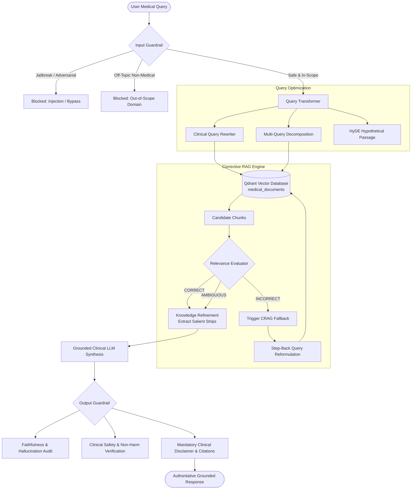

# Clinical Medical RAG with Advanced Optimization, Guardrails & CRAG

This project implements an enterprise-grade, evidence-based Clinical Retrieval-Augmented Generation (RAG) system with persistent vector indexing in **Qdrant DB**, **Query Transformation**, **Input Guardrails**, **Corrective RAG (CRAG)**, and **Output Guardrails**.

---

## 🏗️ Architecture Overview



---

## 📁 Repository Structure

```
rag/
├── data/                               # 11 Official Medical Guidelines PDFs (715 pages)
│   ├── antimicrobial_guidelines.pdf
│   ├── ari_children_quick_ref.pdf
│   ├── ayurveda.pdf
│   ├── cardiovascular_diseases.pdf
│   ├── dengue.pdf
│   ├── general_surgery.pdf
│   ├── hypertension_full.pdf
│   ├── hypertension_quick_ref.pdf
│   ├── malaria.pdf
│   ├── neurology.pdf
│   └── obstetrics_gynaecology.pdf
├── ingestion/
│   └── indexing.py                     # Document loader, chunker, OpenAI embedder & Qdrant indexer
├── qdrant_db/                          # Persistent local Qdrant vector database (2,151 points)
│   ├── collection/
│   └── meta.json
└── retrival/
    ├── query_transformer.py            # Rewriting, Sub-Query Decomposition & HyDE
    ├── guardrails.py                   # InputGuardrail & OutputGuardrail
    ├── crag.py                         # Corrective RAG Evaluator & Knowledge Refiner
    ├── retrival.py                     # Master MedicalRAGPipeline Orchestrator & CLI
    └── evaluate_pipeline.py            # Comprehensive 5-scenario automated test suite
```

---

## 🛠️ Optimization Techniques Implemented

### 1. Vector Database Ingestion (`ingestion/indexing.py`)
- **Engine**: Local persistent `QdrantClient`.
- **Collection**: `medical_documents` (1536-dimensional Cosine metric).
- **Chunking**: `RecursiveCharacterTextSplitter` (chunk size: 1000, overlap: 150) preserving document and page metadata.
- **Idempotency**: Deterministic UUIDv5 hashing based on `source_file|page|start_index|content` prevents duplicate chunks on re-runs.
- **Scale**: 715 pages loaded across 11 clinical documents, 2,151 chunks indexed in batches.

### 2. Query Transformer (`retrival/query_transformer.py`)
- **Clinical Rewriter**: Converts informal or vague user phrasing into standard clinical terminology and pharmacologic classifications.
- **Multi-Query Decomposition**: Deconstructs multi-faceted clinical questions (e.g., diagnosis, first-line treatment across trimesters, contraindications) into 2-3 focused sub-queries for multi-perspective vector retrieval.
- **HyDE (Hypothetical Document Embeddings)**: Synthesizes a hypothetical textbook passage to bridge the vector gap between short queries and detailed guidelines.

### 3. Input Guardrail (`retrival/guardrails.py`)
- **Adversarial / Injection Defense**: High-speed regex pattern matching + LLM security auditor to intercept prompt injections, instruction overrides ("ignore prior instructions", "DAN", system prompt extraction).
- **Domain Scope Enforcement**: Validates that queries strictly pertain to clinical practice, pharmacology, symptoms, surgery, pediatrics, obstetrics, cardiology, or general health. Rejects non-medical requests (e.g. software coding, finance, crypto).
- **Harm & Toxicity Screening**: Blocks self-harm and dangerous illegal substance synthesis inquiries.

### 4. Corrective RAG (CRAG) (`retrival/crag.py`)
- **Document Relevance Evaluator**: Grades every retrieved chunk individually as `CORRECT`, `AMBIGUOUS`, or `INCORRECT` with confidence scoring.
- **Knowledge Refinement**: Discards noisy, off-topic chunks and extracts only the most salient clinical sentences ("knowledge strips").
- **Corrective Fallback & Routing**:
  - If retrieval confidence is low (`INCORRECT`), CRAG triggers step-back query reformulation and launches an alternative search.
  - If the database lacks documentation for a query, it safely reports the limitation rather than hallucinating answers.

### 5. Output Guardrail (`retrival/guardrails.py`)
- **Faithfulness / Hallucination Verification**: Cross-references every medical claim in the response against the retrieved clinical context.
- **Clinical Safety Verification**: Checks for dangerous dosages or unverified self-treatments.
- **Mandatory Clinical Disclaimer**: Enforces standard evidence-based medical disclaimers and guideline citations.

---

## 🚀 How to Run

### 1. Indexing Documents into Qdrant
```powershell
python rag/ingestion/indexing.py
```

### 2. Querying the Pipeline via CLI
```powershell
# Specific query
python rag/retrival/retrival.py --query "What are the warning signs and fluid management guidelines for dengue fever?"

# Interactive default demonstration
python rag/retrival/retrival.py
```

### 3. Running the Automated Evaluation Suite
```powershell
python rag/retrival/evaluate_pipeline.py
```

All 5 test cases will run and output verification results:
- **Test 1**: Standard Clinical Query (Hypertension) -> `[PASSED]`
- **Test 2**: Multi-Part Query (Malaria in Pregnancy) -> `[PASSED]`
- **Test 3**: Prompt Injection Attack Defense -> `[PASSED]`
- **Test 4**: Off-Topic Request Interception -> `[PASSED]`
- **Test 5**: Out-of-Knowledge CRAG Fallback -> `[PASSED]`
